# Homework Report
Erik William Andreasson | X1150052

## Overview
This report describes working with the agentic pipeline to perform basic data analysis and pattern mining on the Reddit-stock-sentiment.csv dataset using the previously developed tools. This report describes the process of working through the dataset via a conversation with the agent as well as discusses the results of the chat. Note that none of the tools received an error or faulty output during the entire workflow, demonstrating the generalization of the tools.

## Run History Disclaimer
During the analysis of the dataset I accidentally pressed a shortcut key turning the chat section into a raw formatted cell. Therefore, I needed to restart once. However, despite the session being destroyed the result id numbers continued from their previous position. This keeps everything intact besides having to reload the data and rebuild the document term matrix.

## Data Contents
Upon loading the dataset, we receive result id *load_dataset_1* which shows that we have 847 documents across three sentiment categories. The document counts for each category are given as follows:

| Category | Number of Documents |
| ----------- | ----------- |
| 0.0 (Neutral) | 423 |
| -1.0 (Negative) | 315 |
| 1.0 (Positive) | 109 |

Using the inspect data tool with result id *inspect_data_2* we can obtain the breakdown of the category distribution:

| Category | Percentage of total |
| ----------- | ----------- |
| 0.0 (Neutral) | 49.941% |
| -1.0 (Negative) | 37.19% |
| 1.0 (Positive) | 12.869% |

Observe that the categories have a high class imbalance where the positive sentiment category has nearly four times fewer documents than the neutral sentiment and three times fewer documents than the negative sentiment. This is a negative result since such a large class imbalance can make pattern mining and analysis of topic terms for the positive category much more difficult as compared to the other categories. With a low amount of data, finding category specific terms that are frequent enough to constitute comparable analysis to the more prevalent categories is a challenge. Therefore, comparison between categories may be much more difficult.

The inspect data tool also provides two example documents for each category truncated to 200 characters. With this we can make some simple observations on the dataset for each category.

*0.0*

> "What are we gonna call it when Wendy's is gone."

> "All proceeds from elected officials and those appointed performing official acts should go to the public treasury."

*-1.0*

> "China has been preparing for this and this administration lies, is terrible at negotiating, and cannot be trusted with an so-called *deals.\n\nThis administration is barely treading water and is likely..."

> "Do we have a copy of trump’s kindergarten graduation certificate? Ideally the long form version."

*1.0*

> "Nah he's pretty spot on. Trump supporters are hated globally"

> "I think it’s gonna work itself out. I bought the doom and gloom at 4900 and deleted my trading app."

It is difficult to make any broad conclusions on the dataset from the examples above since the content is on different subjects and their length is very short. The language used is also different in all of the examples. However, we can observe that document labeled as positive sentiment does not necessarily have to contain positive words. For example, the two documents in the positive sentiment category contain the words "hated" and "doom and gloom" respectively. These are not positive words, but the conversation is labeled as such. The main conclusion that can be drawn is that there will be a high variance in the content and terminology of social media documents such as these. 

## Data Cleaning
In order to proceed, the data needs proper cleaning in order to ensure there are no obvious errors polluting our downstream analysis. To this end, the data is checked for missing values in the text column as well as for duplicate rows. 

With result id check_missing_3 we find that there are no missing values. However, checking duplicates with result id check_duplicates_4, we find that there are 23 duplicate rows in the data. These are removed by the tool and do not affect the analysis. Likely these are bot posts or spam since the data is pulled from a social media website.

## Summary Statistics
To further aid our downstream analysis and understanding of the dataset, the agent was directed to calculate some summary statistics using the describe data tool. This tool provides information on the number of characters in the text column of the dataset. The results of which are given as result id describe_data_5 and presented below:

*Document length in characters, overall and per category:*

| Statistic | Overall | -1.0 | 0.0 | 1.0 |
| ----------- | ----------- | ----------- | ----------- | ----------- |
| Count | 813.0 | 315 | 391 | 107 |
| Mean | 147.19 | 152.82 | 137.87 | 164.64 |
| Standard Deviation | 239.01 | 190.70 | 257.42 | 292.14 |
| Min | 1.0 | 4.0 | 1.0 | 4.0 |
| 25th Percentile | 39.0 | 47.5 | 30.5 | 47.5 |
| Median (50%) | 78.0 | 96.0 | 68.0 | 77.0 |
| 75th Percentile | 164.0 | 183.5 | 141.0 | 166.5 |
| Max | 2737.0 | 2028.0 | 2737.0 | 2444.0 |

The above results are also visualized in the below figure:

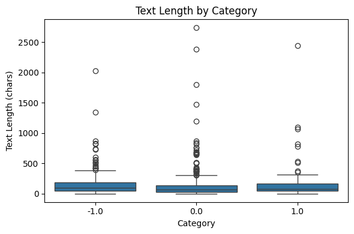

Both the summary statistics and the figure clearly show that the length of the documents is very short. The median for the whole dataset is at 78 characters while for each category the median is between 68 and 96 characters. This result is not surprising for social media text where a post is often a short comment, statement, or question. However, this does mean finding topic specific terms in a single document may be difficult since every comment does not necessarily have to contain topic specific words. The ubiquity of stopwords in the english language may turn a 68 character comment into a considerably shorter one. This makes the result of comparisons between documents with methods like cosine similarity highly variable.

Furthermore, as in most text datasets, the variance in the length of the documents is massive with many outliers in all categories. Some outliers, as shown towards the top of the figure, are monumentally massive as compared to the majority of all documents within the category. However, some outliers have exceptionally low minimum values. The presence of these large outliers and the generally high variance in the majority of the data makes our further analysis more difficult since it can affect the results of pattern mining and dimensionality reduction.

## Feature Matrix
Due to the already low number of documents, it was not necessary to perform subsampling on this dataset. Instead, the agent was directed to build the document term matrix. The result has id build_dtm_6 and has the following result:

| Metric | Value |
| ----------- | ----------- |
| Documents (n_documents) | 813 |
| Terms (n_terms) | 4,313 |
| Non-zero Elements (non_zero) | 16,659 |
| Total Matrix Elements (total_elements) | 3,506,469 |
| Sparsity Percentage (sparsity_pct) | 99.52% |

Sample Feature Names: `['00', '000', '01378', '02', '027', '03', '06', '08', '10', '100', '1000', '10000', '100k', '100x', '10k']`

Observe the extreme sparsity of the matrix. The absolute vast majority of terms only show up very few times in documents. While this makes the data a bit intensive to work with, it can also work in favor of our analysis. Identifying unique terms may allow us to link certain terms to certain categories via domain specific terminology. However, due to the low amount of terms and words across the entire dataset, finding enough unique terminology in order to differentiate may be more difficult than if there was double or more the amount of documents available.

The agent was also directed to plot a heatmap of a slice of the document term matrix, result id dtm_heatmap_8. As the tool slices the first 20 documents and the first 20 terms in alphabetical order, the terms shown are number strings such as "00", "01378", and "10yr". Only three cells in the 400 cell slice are non-zero, where document 3 contains "116" three times, document 9 contains "10" once, and document 13 contains "10" twice. While the slice itself is not very informative about the content of the documents, it gives a visual picture of the 99.52% sparsity of the matrix.

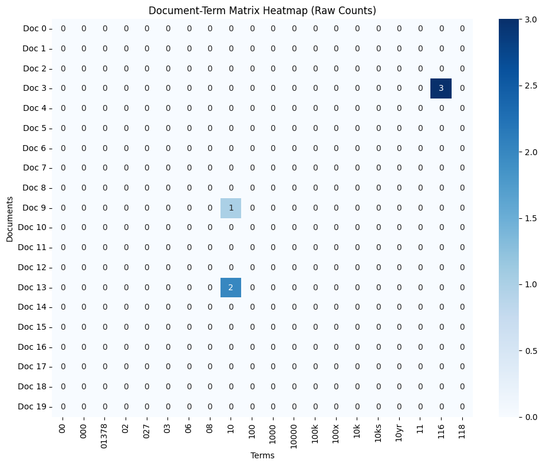

Given this idea, the agent was directed to use the term frequency tool for further analysis. The results are given with id term_frequency_7.

| Metric | Value |
| ----------- | ----------- |
| Total Terms | 4,313 |
| Total Corpus Words | 20,315 |

*Top 15 Most Frequent Terms:*

| Rank | Term | Total Frequency |
| ----------- | ----------- | ----------- |
| 1 | the | 874 |
| 2 | to | 554 |
| 3 | and | 471 |
| 4 | is | 386 |
| 5 | it | 338 |
| 6 | of | 299 |
| 7 | in | 278 |
| 8 | that | 220 |
| 9 | for | 209 |
| 10 | this | 209 |
| 11 | you | 195 |
| 12 | on | 167 |
| 13 | are | 151 |
| 14 | they | 148 |
| 15 | he | 132 |

From the top 15 words we can clearly see the dominance of stopwords in the english language. Words like "the", "of", and "to" appear in a large proportion of all english documents regardless of their purpose, content, or category. Unfortunately, the tool specification in the agent dev section of the assignment specifically disallowed the removal of these stop words via the CountVectorizer when building the document term matrix. This means that this unhelpful noise needs filtering by other means in order to surface more interesting domain specific terminology.

## Filtering
The first attempt to filter some noisy words out was using the variance filter which calculates the variance of each term's count across documents. The result id is variance_filter_9. Running the variance filter tool with threshold 0.0 retains all terms, but it shows us the top 15 terms by variance:

| Initial Terms | Terms Kept | Terms Removed |
| ----------- | ----------- | ----------- |
| 4,313 | 4,313 | 0 |

*Top 15 Terms by Variance:*

| Rank | Term | Variance |
| ----------- | ----------- | ----------- |
| 1 | the | 5.134592 |
| 2 | to | 2.175264 |
| 3 | and | 1.783681 |
| 4 | is | 1.056252 |
| 5 | you | 0.981831 |
| 6 | of | 0.899183 |
| 7 | in | 0.884305 |
| 8 | it | 0.764426 |
| 9 | for | 0.471429 |
| 10 | that | 0.470440 |
| 11 | will | 0.422092 |
| 12 | this | 0.348428 |
| 13 | they | 0.345705 |
| 14 | are | 0.343117 |
| 15 | he | 0.342642 |

It is immediately apparent that it will not be possible to remove the stop words using a variance filter since the filter only removes terms with a variance lower than the threshold. Due to their ubiquity in the dataset, their variance is driven higher than any other word. Setting the threshold that high would remove all of the words. Instead, the variance filter could be used to remove words that are so rare that they become uninformative in distinguishing categories. Words like typos, odd names, or other low frequency terms.

Nevertheless, it is interesting to note that the magnitude of the variance is much lower than that of the newsgroup dataset. This is a direct result of the much lower amount of textual content in the Reddit data. Since there are fewer words per document, the term frequency becomes much lower which drives the overall variance down for all terms, even those with a relatively low variance to the top 15. In short, the variance of all terms is scaled down by the amount of textual content available to calculate on.

A few thresholds were tried with the results given as:

| Threshold | Number of terms kept | Result ID |
| ----------- | ----------- | ----------- |
| 0.0 | 4,313 | variance_filter_9 |
| 0.05 | 93 | variance_filter_10 |
| 0.01 | 490 | variance_filter_11 |
| 0.001 | 4,313 | variance_filter_12 |
| 0.005 | 792 | variance_filter_13 |

The top 15 was of course unchanged in all five thresholds. The results show that around 80% of the terms have a variance between 0.001 and 0.005 with many terms likely having very similar variance values. Therefore, working in this range of thresholds will likely give the best results by filtering out low impact terms like one-off typos while potentially preserving the topic specific terms. Nevertheless, the tools, as written by the spec, do not actually remove any terms.

To further filter, the agent was directed to use Pearson and Spearman filters on all three labels. Working through some different thresholds, the best analysis was found when comparing the Pearson 0.05 threshold result to the Spearman 0.05 result. On the negative label, we find a similar result where around 87% of the terms have a Pearson correlation between 0.01 and 0.05. This shows that the correlation for most terms is very similar, with only a few terms having a correlation retained by the filter. 

The results of the Pearson correlation filter are given in the following table with id numbers shown:

| Target Class | Threshold | Initial Terms | Terms Kept | Terms Removed | Result ID |
| ----------- | ----------- | ----------- | ----------- | ----------- | ----------- |
| -1.0 | 0.0 | 4,313 | 4,313 | 0 | pearson_filter_14 |
| -1.0 | 0.005 | 4,313 | 4,252 | 61 | pearson_filter_15 |
| -1.0 | 0.007 | 4,313 | 4,134 | 179 | pearson_filter_16 |
| -1.0 | 0.05 | 4,313 | 355 | 3,958 | pearson_filter_17 |
| -1.0 | 0.01 | 4,313 | 4,102 | 211 | pearson_filter_18 |
| 1.0 | 0.05 | 4,313 | 693 | 3,620 | pearson_filter_19 |
| 0.0 | 0.05 | 4,313 | 408 | 3,905 | pearson_filter_20 |

As compared to the newsgroup dataset, the Pearson correlation does a better job of surfacing topic specific words that could be used to differentiate labels on documents. The top 15 terms always include words related to economy, politics, or feelings. The reason Pearson may be finding more topic specific words on the Reddit dataset as compared to the newsgroups is that the Reddit posts contain no email headers or signatures. In the newsgroup dataset there were specific yet uninformative email terms and names with high frequencies in some documents of the label. This pushed out the topic words, while here the topic words are able to gain higher correlation. Stopwords are still present however, as "he", "his", "him", and "will" are among the top terms for the negative label.

The top 15 words for the Pearson 0.05 thresholds can be found below for each label:

*0.0:*
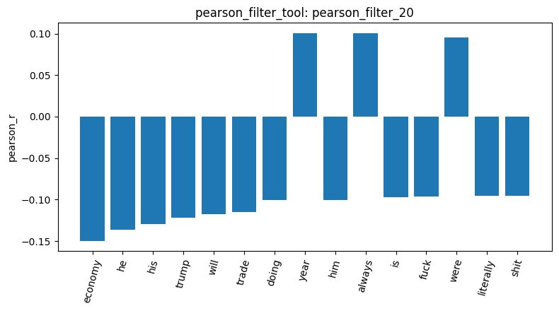

*1.0:*
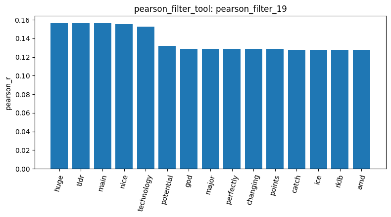

*-1.0:*
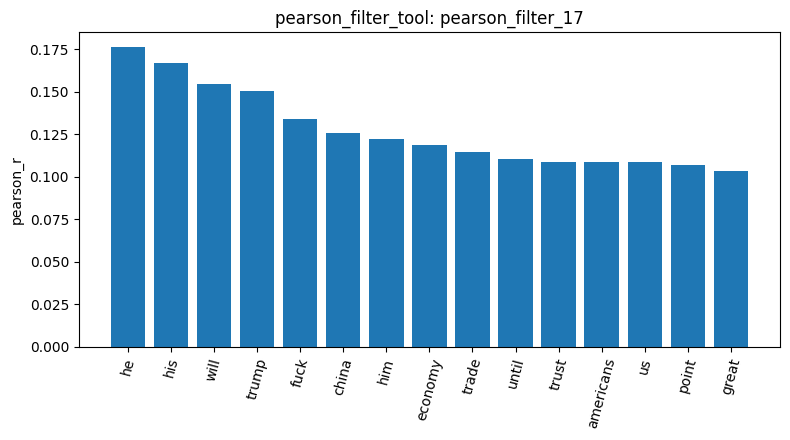

Another observation on the result is that each label has different terminology with high correlation. The positive terms seem to focus more on development, technology, and more positive words like "nice", "major", and "perfectly". Interestingly, the neutral correlation surfaces one vs rest negative correlations much more than any other term. This indicates that neutral posts are defined by their lack of emotional and topic specific terms.

Compare this result to the values for Spearman at the same thresholds and on the same labels:

| Target Class | Threshold | Initial Terms | Terms Kept | Terms Removed | Result ID |
| ----------- | ----------- | ----------- | ----------- | ----------- | ----------- |
| -1.0 | 0.05 | 4,313 | 362 | 3,951 | spearman_filter_21 |
| 1.0 | 0.05 | 4,313 | 696 | 3,617 | spearman_filter_22 |
| 0.0 | 0.05 | 4,313 | 435 | 3,878 | spearman_filter_23 |

*0.0:*
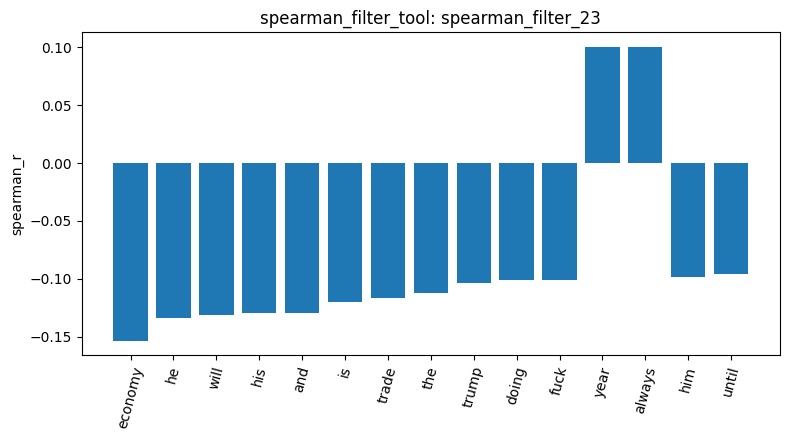

*1.0:*
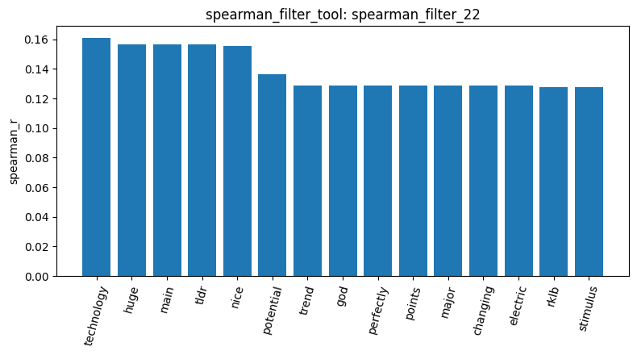

*-1.0:*
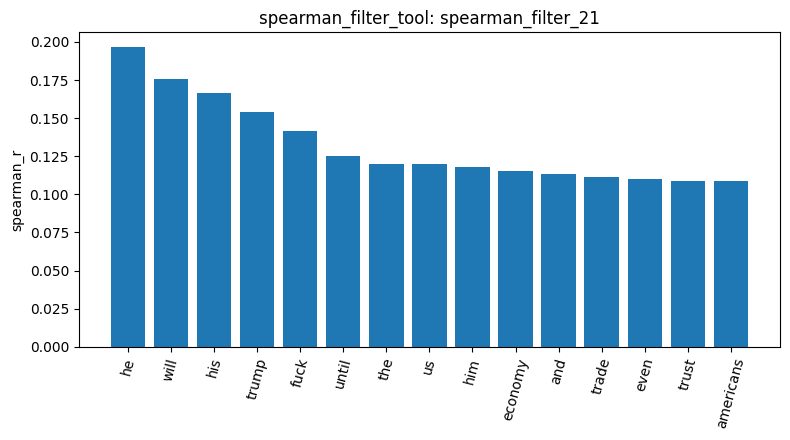

Observe that some of the terms related to politics, economics, and conflict using Spearman have been replaced by generics in the negative sentiment documents. Compared to the positive sentiment documents where the majority of top 15 terms are the same as for Pearson. This may be because having more textual content in the negative sentiment, the label with the longest documents, causes the generic terms to be counted more frequently across documents which pushes the correlation for those terms higher. The reason this is observed in Spearman as opposed to Pearson is that Spearman rewards frequency across the whole set of documents by squashing the variance while Pearson rewards high term counts in few documents.

## Pattern Mining
To compare how the filtering method affects the mined patterns, the agent was directed to mine frequent patterns on the negative label using both the variance and tfidf filters with both FPGrowth and MaxFPGrowth. The positive label was mined with the variance filter and FPGrowth only. Since the categories are much smaller than in the newsgroup dataset, the minimum supports from the master notebook would have been far too high to use. Instead the minimum support was stepped up or down from run to run depending on how many patterns were found. The results are given below:

| Result ID | Category | Filter | Algorithm | Min support | Patterns |
| ----------- | ----------- | ----------- | ----------- | ----------- | ----------- |
| mine_patterns_27 | -1.0 | variance | FPGrowth | 8 | 8 |
| mine_patterns_28 | -1.0 | variance | FPGrowth | 5 | 65 |
| mine_patterns_29 | -1.0 | variance | FPGrowth | 3 | 226 |
| mine_patterns_30 | 1.0 | variance | FPGrowth | 5 | 7 |
| mine_patterns_31 | 1.0 | variance | FPGrowth | 3 | 62 |
| mine_patterns_32 | -1.0 | tfidf | FPGrowth | 30 | 3 |
| mine_patterns_33 | -1.0 | tfidf | FPGrowth | 20 | 8 |
| mine_patterns_34 | -1.0 | tfidf | FPGrowth | 12 | 20 |
| mine_patterns_35 | -1.0 | tfidf | MaxFPGrowth | 10 | 30 |
| mine_patterns_36 | -1.0 | tfidf | MaxFPGrowth | 15 | 13 |
| mine_patterns_37 | -1.0 | tfidf | MaxFPGrowth | 30 | 3 |
| mine_patterns_38 | -1.0 | variance | MaxFPGrowth | 5 | 65 |

Looking at the variance result for the negative label, result id mine_patterns_27, minimum support 8 only gives 8 patterns: "war", "buying", "feel", "know", "trust", "support", "country", and "worse", all with support 8. Dropping the minimum support to 5, result id mine_patterns_28, gives 65 patterns where the words shown are much more charged, for example "delusional", "idiot", "clown", "retarded", "congress", and "risk". At minimum support 3, result id mine_patterns_29, the count grows to 226 but the words shown become generic conversational words like "personally", "starting", "honestly", "exactly", and "forward". Therefore, minimum support 5 gave the most relevant patterns for the negative label.

The positive label only has 109 documents, so minimum support 5, result id mine_patterns_30, only found 7 patterns: "new", "years", "tariffs", "better", "economy", "way", and "doing". Lowering to minimum support 3, result id mine_patterns_31, gives 62 patterns with words like "green", "high", "perfectly", "worth", and "buy". Interestingly, "tldr", "main", "points", and "perfectly" also appear here and they are among the top Pearson and Spearman terms for the positive label. The pattern "points main" is also the only pattern longer than a single word that appears in any of the results shown.

The tfidf filter keeps the most frequent words of the category, so the minimum support was started much higher. At minimum support 30, result id mine_patterns_32, only "china", "just", and "trump" remain. At 20, result id mine_patterns_33, the 8 patterns add "going", "think", "people", "market", and "like". At 12, result id mine_patterns_34, the 20 patterns include "trade", "tariffs", "economy", and "money". Compared to the variance filter, the tfidf words are clearly more topic specific to stocks and politics, while the variance filter surfaces the more emotional words of the negative posts. However, tfidf also keeps generic words like "just", "like", "think", and "don" which have some of the highest supports. These results highlight the differences between the two methods where tfidf is finding the terms more frequent to all documents in the label which naturally is economics and politics related in a stock trading forum. 

Running MaxFPGrowth shows that there are almost no patterns longer than a single word. With tfidf at minimum support 30, result id mine_patterns_37, the 3 maximal patterns are exactly the same as the 3 FPGrowth patterns in mine_patterns_32. At minimum support 15, result id mine_patterns_36, all 13 maximal patterns are single words, and at 10, result id mine_patterns_35, the 15 shown out of 30 are all single words like "xi", "literally", "shit", and "american". Similarly, the variance filter with MaxFPGrowth at minimum support 5, result id mine_patterns_38, gives 65 patterns which is exactly the same number as FPGrowth in mine_patterns_28. Equal counts mean no frequent pattern longer than one word exists at min_sup 5.

Considering these results, the short length of the documents is the main limit on pattern mining in this dataset. With a median of 78 characters, very few posts contain the same two words, so the mined patterns are essentially a list of frequent single words rather than sets of co-occurring words. Unlike the newsgroup dataset, there are no header words dominating the patterns, and the words that are found do describe the label. The negative label gives words about politics, trade, and the economy, while the positive label gives more positive sentiment words as well as trading words. A dataset with longer posts, or many more posts per label, would likely be needed for patterns longer than one word to reach a useful minimum support.

## Dimensionality Reduction

The results of applying PCA are given from result id reduce_dimensions_39:

| Number of Components | Total Documents Transformed |
| ----------- | ----------- |
| 3 | 847 |

| Component | Explained Variance Ratio | Raw Value |
| ----------- | ----------- | ----------- |
| Component 1 | ~27.00% | 0.2700265316919034 |
| Component 2 | ~4.99% | 0.049919992611347115 |
| Component 3 | ~3.86% | 0.03859028207920539 |
| **Cumulative** | **~35.85%** | |

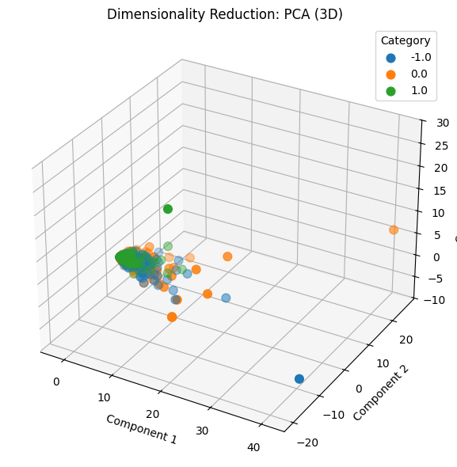

The UMAP method gave from result id reduce_dimensions_40:

| Number of Components | Total Documents Transformed |
| ----------- | ----------- |
| 3 | 847 |

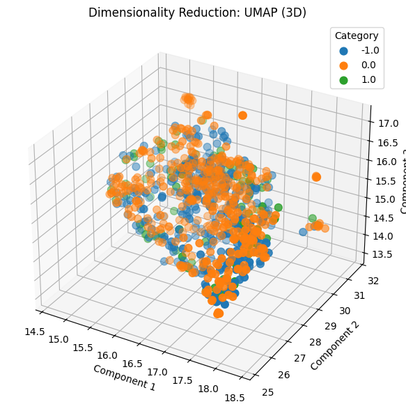

The t-SNE method gave from result id reduce_dimensions_41:

| Number of Components | Total Documents Transformed |
| ----------- | ----------- |
| 2 | 847 |

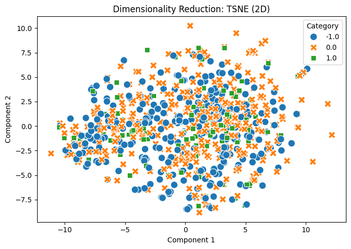

As observable in the PCA plot, the large outliers that were identified in the summary statistics step are dominating the result. This is nearly the same outcome as for the newsgroup dataset where large outliers massively affect the result, but in this case much less variance is explained by the components. The outliers push the variance high in specific directions which causes PCA to select that component for the linear transform. However, this resulted in pushing all documents into nearly one point making any clustering unobservable. Furthermore, since stop words are not removed and no filtering is done by this tool, as directed by the tool specification, we also get a lot of vectors with high similarity just on raw counts. This also pushes everything together.

Observing the UMAP and t-SNE plots there is clear intermixing of the categories with essentially no separation at all. One explanation for this behavior is the text length of the documents. With the median being between 68-96 characters for all of the categories, there are simply not enough terms in one specific document to clearly separate it from another document. The inclusion of the stopwords and generics means that only a handful of terms in a document are truly unique, which may push some categories in a certain direction of the target space, yet ultimately the large number of generics pull everything into one cluster anyway. Another plausible explanation is that since all documents are focused on a single topic, namely trade and stocks, then their similarity is high regardless of the classification due to the number of topic words in comparison to sentiment words.

## Labels and Similarity

The agent was directed to one hot encode the labels. The result is given as id binarize_labels_42. This does nothing since no other tool depends on the result. If there were a later classifier or comparison then the resulting dataframe could be used.

The cosine similarity implementation requires indexes for documents or the text data itself. Due to the limitations of the tools available to the agent, the sample output from the inspect data tool was used to calculate cosine similarity between two documents. Calculating for two "-1.0" documents from result id cosine_similarity_45 gave:

> **Document A (-1.0):** "China has been preparing for this and this administration lies, is terrible at negotiating, and cannot be trusted with an so-called *deals.*\n\nThis administration is barely treading water and is likely..."
>
> **Document B (-1.0):** "Do we have a copy of trump’s kindergarten graduation certificate? Ideally the long form version."
>
> **Cosine Similarity Score: 0.0**

Then performing the similarity calculation for document A and a document from category "1.0", result id cosine_similarity_46, gave:

> **Document A (-1.0):** "China has been preparing for this and this administration lies, is terrible at negotiating, and cannot be trusted with an so-called *deals.*\n\nThis administration is barely treading water and is likely..."
>
> **Document B (1.0):** "I think it’s gonna work itself out. I bought the doom and gloom at 4900 and deleted my trading app."
>
> **Cosine Similarity Score: 0.2283**

| Result ID | Document Pair | Cosine Similarity Score |
| ----------- | ----------- | ----------- |
| cosine_similarity_45 | -1.0 vs -1.0 | 0.0 |
| cosine_similarity_46 | -1.0 vs 1.0 | 0.2283 |

There are some interesting observations to be made from these results. In the first comparison the similarity score is 0.0 meaning there is no similarity in the texts at all. This is true, the two texts do not share a single term despite belonging to the same sentiment label. Furthermore, the comparison of the negative document with the positive one shows a direct increase in the similarity to 0.2283. However, the similarity is not increased by any topic specific words. Instead the documents now only share the words "and" and "at" which is pushing up the similarity. Both findings indicate that the cosine similarity is a poor measurement of document similarity on these texts simply due to their short length. There is not enough content to effectively use the cosine similarity score as a similarity metric because the variability of the text is higher than their topic specific content. One possible improvement is to filter out all stopwords and generics and then run similarity. Then the similarity could be compared on reduced lists of topic words, where the similarity inside each sentiment label would likely be more consistent and improved. However it may still be high across labels since all documents are in the same topic of trade and stocks.

## Conclusions

From the conversation with the agent and the analysis of the data it is clear that more preprocessing is required before drawing any specific conclusions about the content. Specifically removing the stopwords from the beginning would make subsequent analysis more meaningful. Especially in terms of dimensionality reduction and cosine similarity. Furthermore, the tools need revision since the current spec does not allow the filtering to actually do any work on the data so any filters applied are not used when performing other steps. This makes the preprocessing redundant in the pipeline.

Surprisingly, the pattern mining section of the analysis performed fairly well given the short content of the documents. While longer patterns were difficult to discover, the single word patterns that were found highlight topic specific terminology more than in newsgroups dataset which was dominated by email headers. Perhaps one property of short social media texts is that due to their short content, they are more likely to focus on the point of the question, statement, or comment. This allows the topic specific terminology to surface more easily since it has a higher relative proportion as compared to longer textual content which can contain other generics or templated terms. Therefore, this pipeline was able to find some genuinely unique sentiment classifiable terms.

In conclusion, there are label specific terms to be found in the data, however the documents may be hard to separate on term analysis alone since they are all concentrated on a single topic. Nevertheless, to find more trends and patterns both more data and more work on preprocessing is required.