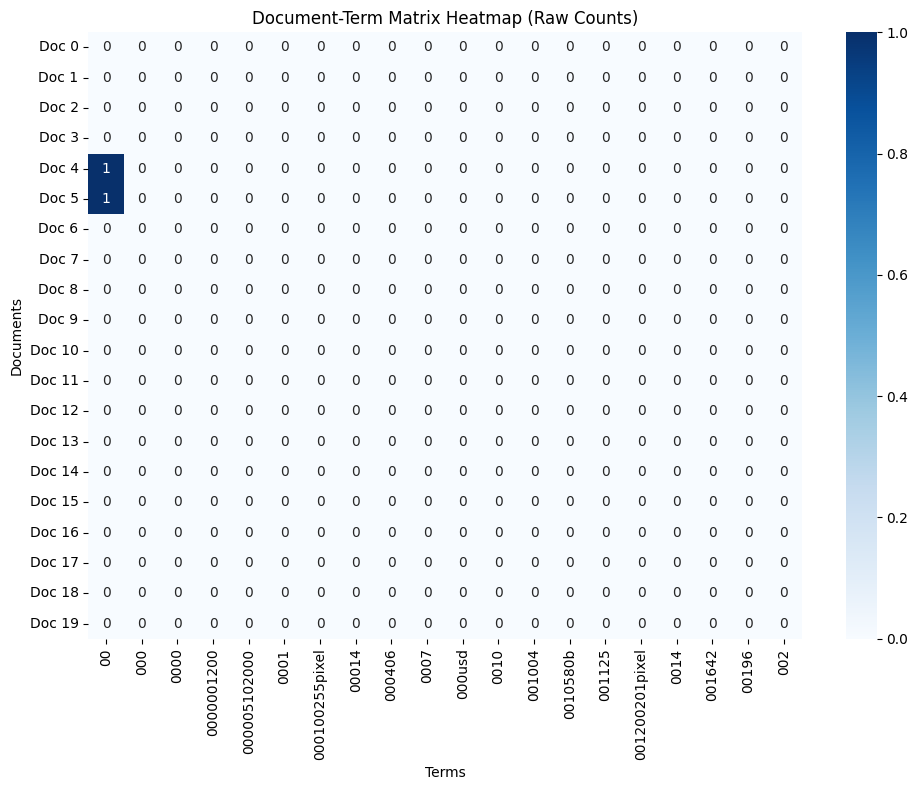
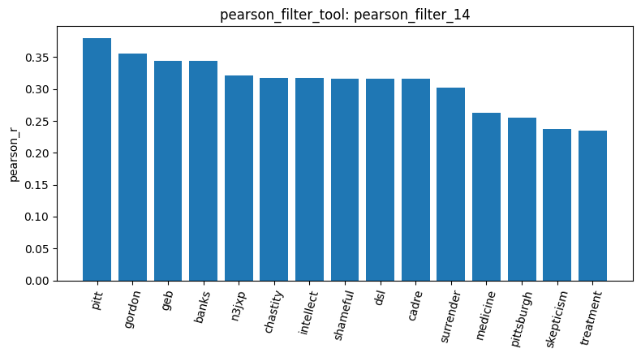
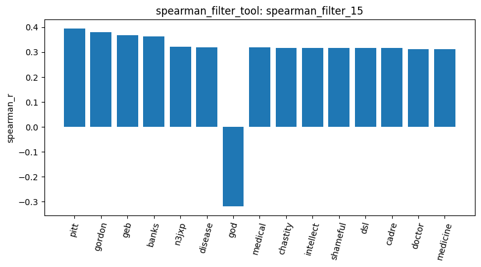
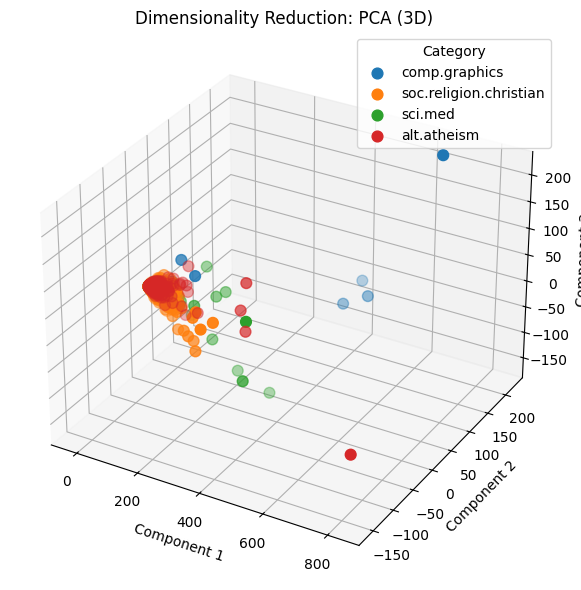
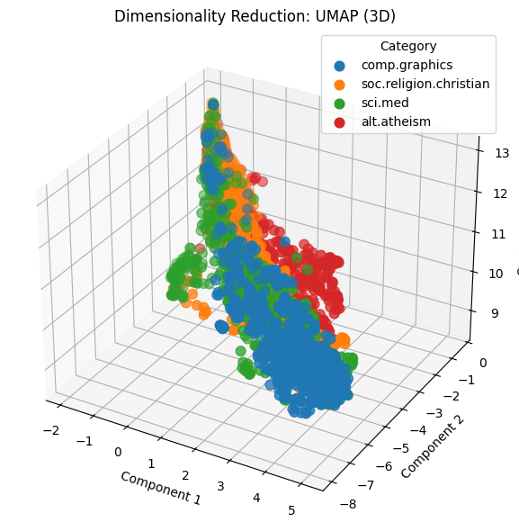

# Homework Report
Erik William Andreasson | X1150052

## Overview
This report describes working with the agentic pipeline to perform basic data analysis and pattern mining on the Reddit-stock-sentiment.csv dataset using the previously developed tools. This report describes the process of working through the dataset via a conversation with the agent as well as discusses the results of the chat.

## Run History Disclaimer
During the analysis of the dataset I accidentally pressed a shortcut key turning the chat section into a raw formatted cell. Therefore, I needed to restart once. However, despite the session being destroyed the result id numbers continued from their previous position. This keeps everything intact besides having to reload the data and rebuild the document term matrix.

## Data Contents
Upon loading the dataset, we receive result id *load_dataset_1* which shows that we have 847 documents across three sentiment categories. The document counts for each category are given as follows:

| Category | Number of Documents |
| ----------- | ----------- |
| 0.0 (Neutral) | 423 |
| -1.0 (Negative) | 315 |
| 1.0 (Positive) | 109 |

Using the inspect data tool with result id *inspect_data_2* we can obtain the breakdown of the category distribution:

| Category | Percentage of total |
| ----------- | ----------- |
| 0.0 (Neutral) | 49.941% |
| -1.0 (Negative) | 37.19% |
| 1.0 (Positive) | 12.869% |

Observe that the categories have a high class imbalance where the positive sentiment category has three times less documents than the neutral sentiment and more than three times less documents than the negative sentiment. This is a negative result since such a large class imbalance can make pattern mining and analysis of topic terms for the positive category much more difficult as compared to the other categories. With a low amount of data, finding category specific terms that are frequent enough to constitute comparable analysis to the more prevalent categories is a challenge. Therefore, comparison between categories may be much more difficult.

The inspect data tool also provides two example documents for each category truncated to 200 characters. With this we can make some simple observations on the dataset for each category.

*0.0*

> "What are we gonna call it when Wendy's is gone."

> "All proceeds from elected officials and those appointed performing official acts should go to the public treasury."

*-1.0*

> "China has been preparing for this and this administration lies, is terrible at negotiating, and cannot be trusted with an so-called *deals.\n\nThis administration is barely treading water and is likely..."

> "Do we have a copy of trump’s kindergarten graduation certificate? Ideally the long form version."

*1.0*

> "Nah he's pretty spot on. Trump supporters are hated globally"

> "I think it’s gonna work itself out. I bought the doom and gloom at 4900 and deleted my trading app."

It is difficult to make any broad conclusions on the datset from the examples above since the content is on different subjects and their length is very short. The language used is also different in all of the examples. However, we can observe that document labeled as positive sentiment does not necessarily have to contain positive words. For example, the two documents in the positive sentiment category contain the words "hated" and "doom and gloom" respectively. These are not positive words, but the conversation is labeled as such. The main conclusion that can be drawn is that there will be a high variance in the content and terminology of social media documents such as these. 

## Data Cleaning
In order to proceed, the data needs proper cleaning in order to ensure there are no obvious errors polluting our downstream analysis. To this end, the data is checked for missing values in the text column as well as for duplicate rows. 

With result id check_missing_3 we find that there are no missing values. However, checking duplicates with result id check_duplicates_4, we find that there are 23 duplicate rows in the data. These are removed by the tool and do not affect the analysis. Likely these are bot posts or spam since the data is pulled from a social media website.

## Summary Statistics
To further aid our downstream analysis and understanding of the dataset, the agent was directed to calculate some summary statistics using the describe data tool. This tool provides information on the number of characters in the text column of the dataset. The results of which are given as result id describe_data_5 and presented below:

*Document length in characters, overall and per category:*

| Statistic | Overall | alt.atheism | comp.graphics | sci.med | soc.religion.christian |
| ----------- | ----------- | ----------- | ----------- | ----------- | ----------- |
| Count | 2,257 | 480 | 584 | 594 | 599 |
| Mean | 1,992.96 | 2,167.30 | 1,557.08 | 2,008.12 | 2,263.18 |
| Standard Deviation | 3,547.66 | 3,581.70 | 4,684.77 | 3,360.44 | 2,080.25 |
| Min | 125 | 228 | 125 | 210 | 171 |
| 25th Percentile | 795 | 931.5 | 572.5 | 849.25 | 969.0 |
| Median (50%) | 1,235 | 1,382.5 | 883.0 | 1,238.5 | 1,649.0 |
| 75th Percentile | 2,059 | 2,170.75 | 1,341.5 | 1,943.25 | 2,770.5 |
| Max | 60,713 | 51,239 | 60,713 | 37,009 | 18,660 |

The above results are also visualised in the below figure:

Both the summary statistics and the figure clearly show that the length of the documents is very short. The median for the whole dataset is at 78 characters while for each category the median is between 68 and 96 characters. This result is not surprising for social media text where a post is often a short comment, statement, or question. However, this does mean finding topic specific terms in a single document may be difficult since every comment does not necessarily have to contain topic specific words. The ubiquity of stopwords in the english language may turn a 68 character comment into a considerably shorter one. This makes the result of comparisons between documents with methods like cosine similarity highly variable.

Furthermore, as in most text datasets, the variance in the length of the documents is massive with many outliers in all categories. Some outliers, as shown towards the top of the figure, are monumentally massive as compared to the majority of all documents within the category. However, some outliers have exceptionally low minimum values. The presence of these large outliers and the generally high variance in the majority of the data makes our further analysis more difficult since it can affect the results of pattern mining and dimensionality reduction.

## Feature Matrix
Due to the already low number of documents, it was not necessary to perform subsampling on this dataset. Instead, the agent was directed to build the document term matrix. The result has id build_dtm_6 and has the following result:

| Metric | Value |
| ----------- | ----------- |
| Documents (n_documents) | 2,257 |
| Terms (n_terms) | 35,788 |
| Non-zero Elements (non_zero) | 365,886 |
| Total Matrix Elements (total_elements) | 80,773,516 |
| Sparsity Percentage (sparsity_pct) | 99.547% |

Sample Feature Names: `['00', '000', '0000', '0000001200', '000005102000', '0001', '000100255pixel', '00014', '000406', '0007', '000usd', '0010', '001004', '0010580b', '001125']`

Observe the extreme sparsity of the matrix. The absolute vast majority of terms only show up very few times in documents. While this makes the data a bit intensive to work with, it can also work in favor of our analysis. Identifying unique terms may allow us to link certain terms to certain categories via domain specific terminology. However, due to the low amount of terms and words across the entire datset, finding enough unique terminology in order to differentiate may be more difficult than if there was double or more the amount of documents available.

The agent was also directed to plot a heatmap of a slice of the document term matrix, result id dtm_heatmap_8. As the tool slices the first 20 documents and the first 20 terms in alphabetical order, the terms shown are number strings such as "00", "0000", and "000100255pixel". Only two cells in the 400 cell slice are non-zero, where documents 4 and 5 both contain "00" once. While the slice itself is not very informative about the content of the documents, it gives a visual picture of the 99.547% sparsity of the matrix.

Given this idea, the agent was directed to use the term frequency tool for further analysis. The results are given with id term_frequency_7.

| Metric | Value |
| ----------- | ----------- |
| Total Terms | 35,788 |
| Total Corpus Words | 691,079 |

*Top 15 Most Frequent Terms:*

| Rank | Term | Total Frequency |
| ----------- | ----------- | ----------- |
| 1 | the | 29,825 |
| 2 | of | 17,660 |
| 3 | to | 17,222 |
| 4 | and | 13,017 |
| 5 | is | 12,343 |
| 6 | in | 11,226 |
| 7 | that | 10,723 |
| 8 | it | 8,447 |
| 9 | you | 6,157 |
| 10 | for | 5,962 |
| 11 | not | 5,285 |
| 12 | this | 5,063 |
| 13 | be | 4,898 |
| 14 | from | 4,877 |
| 15 | are | 4,769 |

From the top 15 word we can clearly see the dominance of stopwords in the english language. Words like "the", "of", and "to" will always appear in all english documents regardless of their purpose, content, or category. Unfortunately, the tool specification in the agent dev section of the assignment specifically disallowed the removal of these stop words via the CountVectorizer when building the document term matrix. This means that this unhelpful noise needs filtering by other means in order to surface more interesting domain specific terminology.

## Filtering
The first attempt to filter some noisy words out was using the variance filter which calculates the variance of each term's count across documents. The result id is variance_filter_9. Running the variance filter tool with threshold 0.0 retains all terms, but it shows us the top 15 terms by variance:

| Initial Terms | Terms Kept | Terms Removed |
| ----------- | ----------- | ----------- |
| 35,788 | 35,788 | 0 |

*Top 15 Terms by Variance:*

| Rank | Term | Variance |
| ----------- | ----------- | ----------- |
| 1 | the | 690.27 |
| 2 | of | 251.62 |
| 3 | to | 186.71 |
| 4 | and | 167.98 |
| 5 | is | 115.43 |
| 6 | in | 76.83 |
| 7 | that | 74.19 |
| 8 | for | 47.76 |
| 9 | it | 46.92 |
| 10 | you | 43.38 |
| 11 | jpeg | 25.14 |
| 12 | not | 23.08 |
| 13 | this | 19.74 |
| 14 | are | 18.57 |
| 15 | be | 16.77 |

It is immediately apparent that it will not be possible to remove the stop words using a variance filter since the filter only removes terms with a variance lower than the threshold. Due to their ubiquity in the dataset, their variance is driven higher than any other word. Setting the threshold that high would remove all of the words. Instead, the variance filter could be used to remove words that are so rare that they become uninformative in distinguishing categories. Words like typos, odd names, or other low frequency terms.

Nevertheless, it is interesting to note that the magnitude of the variance is much lower than that of the newsgroup dataset. This is a direct result of the much lower amount of textual content in the Reddit data. Since there are fewer words in total, the term frequency becomes much lower which drives the overall variance down for all terms, even those with a relatively low variance to the top 15. In short, the variance of all terms is scaled down by a factor of the amount of textual content available to calculate on.

A few thresholds were tried with the results given as:

| Threshold | Number of terms kept | Result ID |
| ----------- | ----------- | ----------- |
| 0.0 | 35,788 | variance_filter_9 |
| 0.05 | 1,710 | variance_filter_10 |
| 0.01 | 5,354 | variance_filter_11 |

The top 15 was of course unchanged in all three thresholds. The results show that around 80% of the terms have a threshold between 0.001 and 0.005 with many terms likely having very similar variance values. Therefore, working in this range of thresholds will likely give the best results by filterin out noisy and generic terms while keeping the topic specific terms. Nevertheless, the tools, as written by the spec, do not actually remove any terms.

To further filter, the agent was directed to use Pearson and Spearman filters on all three labels. Working through some different thresholds, the best analysis was found when comparing the Pearson 0.05 threshold result to the Spearman 0.05 result. On the negative label, we find a similar result where around 80% of the terms have a Pearson correlation between 0.01 and 0.05. Showing that the correlation for most terms is very similar, with only a few terms having a significant correlation retained by the filter. 

The results of the Pearson correlatio filter are given in the following table with id numbers shown:

| Target Class | Threshold | Initial Terms | Terms Kept | Terms Removed | Resul ID |
| ----------- | ----------- | ----------- | ----------- | ----------- | ----------- |
| sci.med | 0.05 | 35,788 | 2,699 | 33,089 | X |

As compared to the newsgroup dataset, the Pearson correlation does a very good job of surfacing topic specific words that can be used to differentiate labels on documents. The top 15 terms always include many words related to war, the economy, or politics. Subjects that are usually associated with stocks as well as potentially negative sentiments on social media. The reason Pearson may be finding more topic specific words on the Reddit dataset as compared to the newsgroups is that due to the shorter textual content, stopwords and generics are in fact proportionally much less of the document as compared to the topic words. Therefore, these topic words are able to gain higher positive correlation without being pushed out by the volume of generics.

The top 15 words for the Pearson 0.05 thresholds can be found below for each label:

*0.0:*

*1.0*

*-1.0*

Another observation on the result is that each label clearly has very different terminology with high correlation. The positive terms seems to focus more on development, technology, and more positive words like "nice", "major", and "perfectly". Interestingly, the neutral correlation surfaces one vs rest negative correlations much more than any other term. This indicates that neutral posts likely contain more generic terms or stopwords which by already being relatively ubiquitos in the text pushes their correlation further down than the absolute value of negative correlations.

Compare this result to the values for Spearman at the same thresholds and on the same labels:

| Target Class | Threshold | Initial Terms | Terms Kept | Terms Removed |
| ----------- | ----------- | ----------- | ----------- | ----------- |
| sci.med | 0.05 | 35,788 | 2,953 | 32,835 |

As shown in the figure, only two more domain specific terms have reached the top 15, namely "medical" and "disease". Otherwise we keep the same terms that are common in the category but not helpful for this category as a concept for new classification. However, note the arrival of "god" as a negatively correlated term, showing that the term "god" is highly frequent in the other categories from the one vs rest correlation value.

## Pattern Mining
To compare how the filtering method affects the mined patterns, the agent was directed to mine frequent patterns within a single category using FPGrowth and MaxFPGrowth. The category "alt.atheism" was mined with both the variance and tfidf filters, and "comp.graphics" was mined with tfidf only. An explicit minimum support was always given (14 for variance and 80 for tfidf) since the default value of 1 and a tfidf with minSup 15 caused the kernel to run out of memory. The specific arguments were taken directly from the master notebook since they were confirmed safe to use. The results are given below:

| Result ID | Category | Filter | Algorithm | Min support | Patterns |
| ----------- | ----------- | ----------- | ----------- | ----------- | ----------- |
| mine_patterns_3 | alt.atheism | variance | FPGrowth | 14 | 8,635 |
| mine_patterns_4 | alt.atheism | variance | MaxFPGrowth | 14 | 368 |
| mine_patterns_5 | alt.atheism | tfidf | FPGrowth | 80 | 4,183 |
| mine_patterns_6 | alt.atheism | tfidf | MaxFPGrowth | 80 | 116 |
| mine_patterns_7 | comp.graphics | tfidf | MaxFPGrowth | 80 | 52 |
| mine_patterns_8 | comp.graphics | tfidf | FPGrowth | 80 | 999 |

Looking at the variance result for "alt.atheism", result id mine_patterns_4, every maximal pattern shown begins with "lines" and most with "lines organization". The remaining words are rare tokens such as names, hosts, and signature text: "dwyer uucp d012s658 ap horus mchp sni" and "net cheers private activities alink ksand bureau cookamunga tourist". The FPGrowth result, mine_patterns_3, shows the same behavior, with only "lines" (480) and "organization" (453) at high support and otherwise low frequency words like "catholic", "definitions", and "1993apr5" at the minimum support. None of these say anything about atheism.

The tfidf result for the same category, result id mine_patterns_5, contains words that describe the category: "atheism" (92), "atheists" (146), "religion" (88), "christian" (82), "believe" (108), and "god" (172). The maximal patterns in mine_patterns_6 combine these with header words, for example "lines subject organization atheism" (87) and "lines subject organization edu writes article god" (90). The same applies to "comp.graphics" in mine_patterns_7 and mine_patterns_8, where the content words are "graphics" (204), "image" (104), "software" (93), "file" and "files", "program", and "code". Tfidf therefore gives more domain specific words in both categories. Note that the variance filter was not run on "comp.graphics", so this comparison is only direct for "alt.atheism".

In either case, the header words are still present, and they dominate the MaxFPGrowth results. All 52 maximal patterns in mine_patterns_7 begin with "lines subject", and most continue with "organization". Many of the longer patterns contain mostly header terms, for example "lines subject organization edu writes article posting host nntp" (105, mine_patterns_6). A maximal pattern is extended by every word that keeps it frequent, so the header words are added to nearly every pattern at no cost in support. The FPGrowth results show the cost. The single word "sure" in mine_patterns_5 appears as four patterns with the same support of 80: "sure", "sure lines", "sure subject", and "lines sure subject".

Considering these results, removing the header words and the other generic email text before building the matrix is likely one of the best ways to improve the pattern mining as well as the features of this dataset. Removing them would shrink the pattern counts, make the maximal patterns consist only of content words, and make the patterns more comparable between categories. The same noise affected the cosine similarity results below, and it likely affects the dimensionality reduction results too. This was not tested in this run since the tools do not allow modifying the text, so it is a conclusion from the patterns and not a measured result.

## Dimensionality Reduction

The results of applying PCA are given from result id reduce_dimensions_9:

| Number of Components | Total Documents Transformed |
| ----------- | ----------- |
| 3 | 2,257 |

| Component | Explained Variance Ratio | Raw Value |
| ----------- | ----------- | ----------- |
| Component 1 | 65.94% | 0.6593700340380808 |
| Component 2 | 4.33% | 0.04330328996584685 |
| Component 3 | 3.60% | 0.03597519897955128 |
| **Cumulative** | **~73.87%** | |

The UMAP method gave from result id reduce_dimensions_10:

| Number of Components | Total Documents Transformed |
| ----------- | ----------- |
| 3 | 2,257 |

*Sample transformed coordinates for the first few documents:*

| Document | Category | Component 1 | Component 2 | Component 3 |
| ----------- | ----------- | ----------- | ----------- | ----------- |
| 0 | comp.graphics | 4.53 | -6.07 | 10.16 |
| 1 | comp.graphics | 1.84 | -5.25 | 11.67 |
| 2 | soc.religion.christian | 0.57 | -3.01 | 11.39 |
| 3 | soc.religion.christian | 3.93 | -6.23 | 10.58 |
| 4 | soc.religion.christian | 1.87 | -5.34 | 11.14 |

As observable in the PCA plot, the large outliers that were identified in the summary statistics step are dominating the result. These outlier push the variance high in specific directions which is likely causing PCA to select that component for the linear transform. However, this has resulted in pushing all documents into nearly one point making any clustering unobservable. Furthermore, since stop words are not removed and no filtering is done by this tool, as in the spec, we also get a lot of vectors with high similarity just on raw counts. This also pushes everything together.

This is likely why UMAP also has trouble differentiating the categories. While there is some separation of "comp.graphics" and "alt.atheism", the rest is quite intermixed. Having multiple views of the 3D plot would make it easier to view how mixed the clusters are.

## Labels and Similarity

The agent was directed to one hot encode the labels. The result is given as id binarize_labels_11. This does nothing since no other tool depends on the result. If there were a later classifier or comparison then the resulting dataframe could be used.

The cosine similarity implementation requires indexes for documents or the text data itself. Due to the limitations of the tools available to the agent, the sample output from the inspect data tool was used to calculate cosine similarity between two documents. Calculating for two "sci.med" documents from result id cosine_similarity_13 gave:

> **Document A (sci.med):** "From: rogers@calamari.hi.com (Andrew Rogers) Subject: Re: Is MSG sensitivity superstition? Organization: Flames 'R Us Lines: 13 NNTP-Posting-Host: calamari.hi.com In article <1993Apr15.153729.13738@w..."
>
> **Document B (sci.med):** "From: lady@uhunix.uhcc.Hawaii.Edu (Lee Lady) Subject: Re: Science and methodology (was: Homeopathy ... tradition?) Summary: Asking the wrong question is the most fundamental error. Keywords: science ..."
>
> **Cosine Similarity Score: 0.1128**

Then performing the similarity calculation for document A and a document from category "alt.atheism", result id cosine_similarity_14, gave:

> **Document A (sci.med):** "From: rogers@calamari.hi.com (Andrew Rogers) Subject: Re: Is MSG sensitivity superstition? Organization: Flames 'R Us Lines: 13 NNTP-Posting-Host: calamari.hi.com In article <1993Apr15.153729.13738@w..."
>
> **Document B (alt.atheism):** "From: darice@yoyo.cc.monash.edu.au (Fred Rice) Subject: Re: Ancient islamic rituals Organization: Monash University, Melb., Australia. Lines: 21 In <16BA6C947.I3150101@dbstu1.rz.tu-bs.de> I3150101@db..."
>
> **Cosine Similarity Score: 0.1692**

| Result ID | Document Pair | Cosine Similarity Score |
| ----------- | ----------- | ----------- |
| cosine_similarity_13 | sci.med vs sci.med | 0.1128 |
| cosine_similarity_14 | sci.med vs alt.atheism | 0.1692 |

The noteworthy aspect of this result is how the similarity increased when comparing documents from two different categories as opposed to lowering. This result is expected since the similarity value is highly variable the shorter the documents being compared are. In this instance the text is limited to only 200 characters, meaning that just a one or two words the same or different can make a large difference in the result. In this case we observe the addition of the words "Lines" and "Organization" were added by document B which made the documents more similar, despite these words having nothing to do with the categories. The key takeaway being that filtering of the text documents from header words and other generics as well using full documents makes the cosine similarity less variable and more meaningful.

## Conclusions

From the conversation with the agent and the analysis of the data it is clear that more preprocessing is required before drawing any specific conclusions about the content. Specifically removing the stopwords from the beginning and filtering email specific terms would make subsequent analysis more meaningful. Especially in terms of dimensionality reduction, cosine similarity, and pattern mining. Furthermore, the tools need revision since the current spec does not allow the filtering to actually do any work on the data so any filters applied are not used when performing other steps. This makes the preprocessing redundant in the pipeline.

In conclusion, there are category specific terms to be found in the data and I believe that the documents are more separable than this analysis indicates. However, to show this a lot more work needs to be done on the preprocessing.